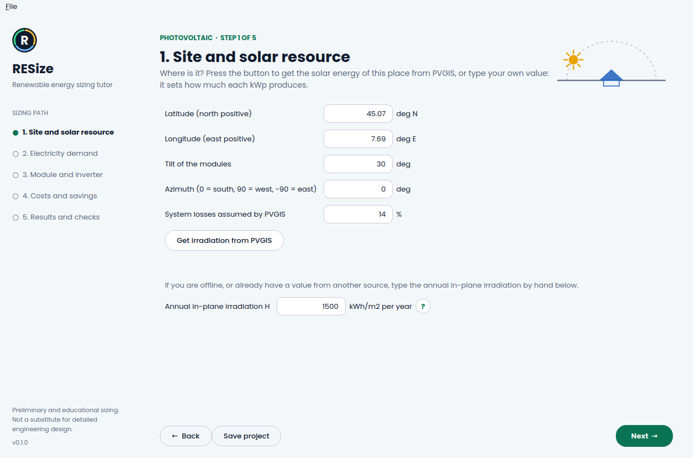
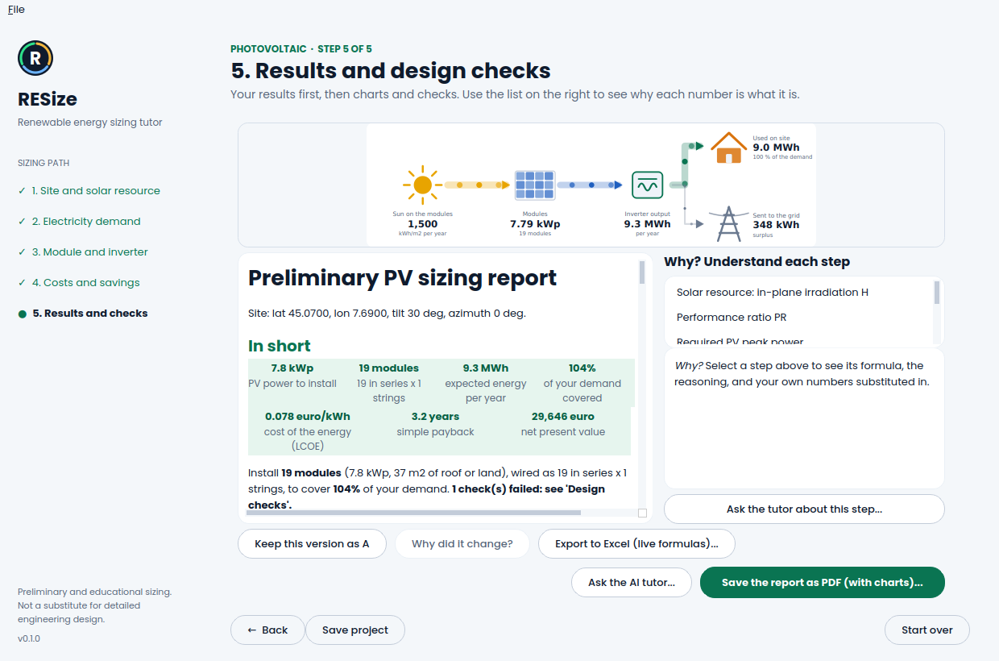
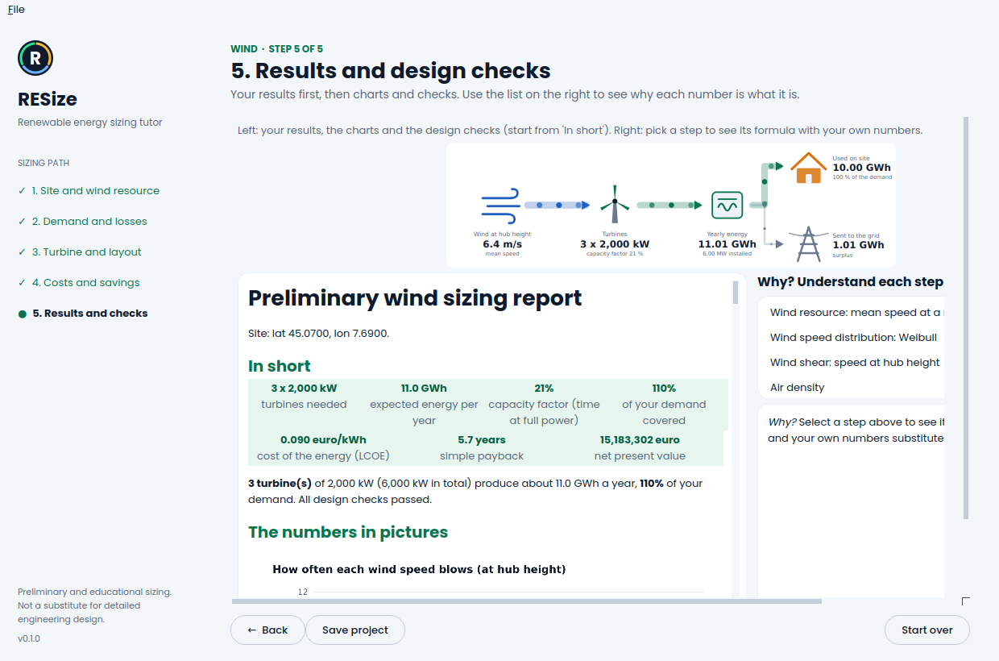
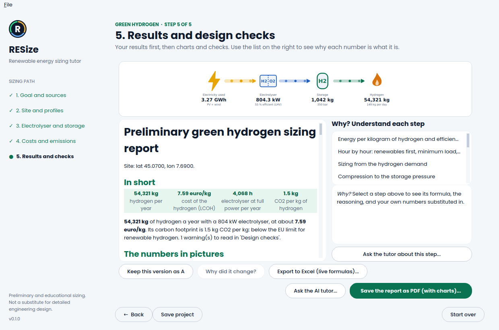
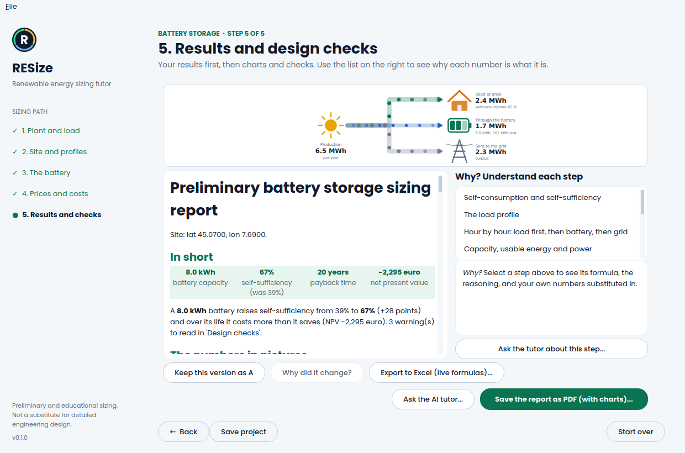
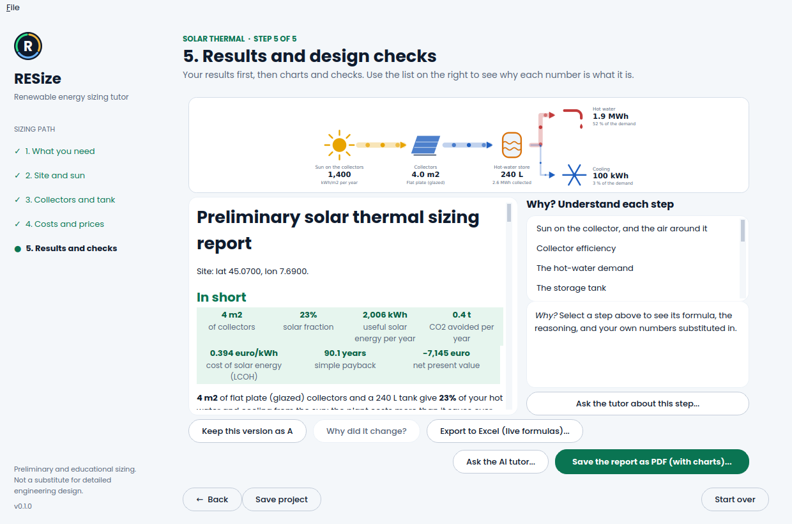

# RESize

**A step-by-step tutor for sizing renewable energy systems.**

RESize guides MSc students (and engineers doing a first-pass design) through the sizing of
renewable energy plants. At every step it shows the formula, the assumptions and the
reasoning, so you learn *why* a choice is made, not just the number that comes out.

> **Status:** early release. Photovoltaic, wind, biomass, green hydrogen, battery storage and solar thermal (with adsorption cooling) are available, plus a technology comparison. Interfaces and results may change.

**User guide:** <https://matteomazzanti99.github.io/RESize/> (one page per technology, with screenshots).


## Download

Get the installer for your system from the
[Releases page](https://github.com/MatteoMazzanti99/RESize/releases):

| System | File | Notes |
|---|---|---|
| Windows | `RESize-windows.zip` | Unzip, run `RESize.exe`. Windows may warn about an unknown publisher (the app is not code-signed): *More info > Run anyway*. |
| macOS | `RESize-macos.zip` | Unzip, right-click `RESize.app` > *Open* the first time (not notarized). |
| Linux | `RESize-linux.tar.gz` | Extract, run `RESize/RESize`. Needs the usual Qt libraries (e.g. `libxkbcommon-x11-0`, `libxcb-cursor0`). |

Prefer Python? See *Quick start* below.

## How it looks

| Photovoltaic: every step explains itself | Results with the energy-flow picture |
|---|---|
|  |  |
| **Wind** | **Green hydrogen** |
|  |  |
| **Battery storage** | **Solar thermal** |
|  |  |

Validation against PVGIS, independent integrations and hand calculations:
[docs/validation](docs/validation/README.md).

## Results at a glance

Every result page (and the PDF) starts with **In short**: the key numbers and a one-sentence
verdict. Then come the charts (energy balance, wind distribution and power curve, heat load
curve, cost build-up, hydrogen per month, comparison of cost, payback, cash flow and CO2), the
design checks sorted by importance, and finally the detailed tables and the formulas.

On the cost pages, a **Country** drop-down fills the electricity and heat prices, the price of
the surplus and the grid emission factor with typical values of 18 countries (editable). If the country does not match the site coordinates, the app warns you.

For every technology (not the comparison), **Export to Excel (live formulas)** writes a workbook in which every
step is a formula with named inputs (change a cell, watch the results move) plus a *Check*
sheet comparing it with the numbers computed by RESize. It is verified in the tests by
recalculating the workbook with LibreOffice.

## Wind module

Start it from the home screen (click the **Wind** card). Steps: site and wind resource
(NASA POWER or your own data, Weibull distribution, shear, air density), demand and losses,
turbine and layout, results. You get the capacity factor, the energy of one turbine, the number
of turbines to cover the demand, land use, design checks, **Why?** panels with your numbers and
a PDF report, like the photovoltaic flow.

The turbine step offers a **library of 55 real turbines** (onshore utility scale and small
distributed machines) with tabulated power curves, taken from the open
[NREL turbine-models](https://github.com/NREL/turbine-models) repository (BSD-3-Clause, see
`THIRD_PARTY_NOTICES.md`). Many of those curves are reference or theoretical designs, not
manufacturer-certified data: for a real project use the manufacturer's curve and a measured
wind resource. Editing a value switches back to the generic curve.


Wind can also use a wake model (step 3, Layout): Jensen wakes over a wind rose for a grid of
staggered rows, giving the real wake loss, the efficiency of every turbine and of every
wind direction, and a turbine count that accounts for it.

## Knowing what to trust, and comparing versions

Every report lists the values still at the program's defaults, the ones you changed and the
ones fetched from PVGIS or NASA POWER (**Which values to check**). **Keep this version as A**
lets you change inputs and come back to a report that compares the two versions and shows what
each changed input did to the results (**Why did it change?**).

## Saving and reopening projects

**Save project** (button at the bottom, or Ctrl+S) writes a small `.resize` file with every value
of every step and, if you downloaded it, the real hourly weather year. **Open a saved
project...** (button on the home page, or Ctrl+O) brings you straight to the results of that
project; press Back to change anything. Files are plain JSON, so they can also be versioned
or shared; a file saved by a newer RESize says so instead of failing.

## Sensitivity analysis

Hydrogen, battery and the technology comparison end with two pictures answering "what if my
numbers are wrong?": a ranking of which input moves the result most, and curves of the result
when each input is 10 or 20 % off (cost of hydrogen, net present value of the battery, cost of
a kWh for every technology when all capital costs or the discount rate move). The comparison
also tells you whether the ranking of the technologies survives.

## Biomass module

Start it from the home screen (click the **Biomass** card) and pick the pathway:

- **Solid biomass boiler** (heat only) and **ORC cogeneration** (heat and power), sized on the
  heat demand with a load duration curve: plant power for the share of heat you want to cover,
  fuel per year from moisture and heating value, silo size, truck loads and ash.
- **Biogas**: digester and CHP engine sized on the electricity demand, with substrate mix,
  methane yield, digester volume and retention time, organic loading rate, heat balance
  (after heating the digester), crop land and digestate.

Every step has **Why?** panels with your numbers, design checks and a PDF report. Fuel and
substrate values are typical handbook figures: replace them with your supplier's specification
or a laboratory methane potential test.

## Green hydrogen module

Start it from the home screen (click the **Green hydrogen** card). Two ways in: from a
**hydrogen demand** (electrolyser and renewable plants are sized for it) or from a
**renewable plant you already have** (how much hydrogen it can make). The electricity can come
from PV, wind, the grid or any combination.

The calculation runs hour by hour over a year: renewables first, electrolyser off below its
minimum load, optional grid top-up limited to a number of full-load hours. You get the
hydrogen per year, full-load hours, curtailment, compression work, storage volume, water, stack
life, the **cost of hydrogen (LCOH)** with its breakdown and the **carbon intensity** compared
with the EU renewable-hydrogen threshold (about 3.4 kg CO2/kg) and with hydrogen from natural
gas. A button downloads one real year of hourly wind and radiation from NASA POWER; offline an
invented year with the same yearly totals is used and the report says so. Costs and emission
factors are round placeholders to replace with quotes.

The hydrogen module also has optional deeper models (step 3): efficiency that depends on the
load (auxiliaries weigh more at part load), stack ageing over the years with replacement,
a storage tank sized hour by hour from the production, and grid purchases in the cheapest
hours of an hourly price profile.

## Battery storage module

Click the **Battery storage** card. It stores the surplus of a PV and/or wind plant for the
hours when the plant produces less than you consume. Five steps: plant and load (home, office,
industry or flat profile), site and hourly profiles (real NASA POWER year or an invented one),
the battery (capacity you choose, smallest battery for a target self-sufficiency, or best
net present value), prices, results. You get self-sufficiency and self-consumption with and
without the battery, cycles, life (cycles or calendar), payback, NPV, LCOS, CO2, a summer
and a winter week hour by hour, and the curves of self-sufficiency and NPV against the size
that show why a bigger battery is not always better. Every step has a "Why?" with the
formula and your own numbers.

PV and wind also have a **Costs and savings** step: installed cost, maintenance, the price you
pay and the price paid for the surplus give the cost of energy (LCOE), payback, NPV and CO2
avoided, with the same sensitivity pictures.

## Solar thermal module (hot water and adsorption cooling)

Click the **Solar thermal** card. Five steps: what you need (hot water, cooling, or both), site
and sun (irradiation on the collectors from PVGIS, air temperature), collectors and tank (flat
plate, evacuated tube or unglazed, with their efficiency curve; the size you choose or the
area that reaches a target solar fraction), costs and prices, results.

The plant is simulated hour by hour for a year with one mixed storage tank. Hot water is drawn
with morning and evening peaks; the backup boiler covers what the sun does not. For **cooling**
the hot water of the collectors drives an **adsorption chiller** (silica gel and water): a heat
driven machine that makes chilled water with almost no electricity, needs 60-90 degC water and
has a thermal COP of about 0.5-0.65. It works when the tank is hot enough, so the model shows
the real average COP of the plant. You get the solar fraction (hot water and cooling), heat
dumped by overheating, a winter and a summer week of the tank temperature, the solar fraction
and the energy per m2 against the collector area, payback, NPV, cost of solar energy, CO2 and
the sensitivity of the NPV. Prices and collector coefficients are round typical values: use
the Solar Keymark certificate of your collector and the datasheet of the chiller.

## Technology comparison

On the home screen, click a technology card to start its project, or **drag two or more cards
into the Compare zone** (they stand facing each other with a "VS" between them) and press **Compare**: after a short clash you land on a **Versus** screen where the bars of each round (cost of energy, payback, net present value, CO2) fill up like life bars; the full report is in the second tab. Photovoltaic,
wind, biogas CHP and green hydrogen are sized for the same yearly energy and put side by side:
cost of energy (LCOE), simple and discounted payback, net present value and avoided CO2, with
**Why?** panels for every formula and a PDF report. Electricity technologies are compared with
the grid; hydrogen is compared, on its heating value, with hydrogen made from natural gas. Prices,
lifetimes and emission factors are round placeholders to replace with local quotes; the model is
an annual balance (no hourly match for the electricity, no incentives or taxes), biogas heat is
not credited and the hydrogen plant runs on an invented hourly year (use the hydrogen flow for
real hourly data).

## Quick start

```bash
pip install -e ".[gui]"
resize            # opens the PV sizing wizard
resize-cli pv-power --demand-kwh 4800 --irradiation 1600 --pr 0.75
```

The wizard guides you through site and solar resource (PVGIS or manual input), demand,
module/inverter datasheet values, then shows the design, automatic checks and a PDF report.
Next to the main values a round **?** button explains the step, and on the results page a
**Why?** panel shows each formula with *your own numbers* substituted in. The same worked
examples are included in the PDF report.

## AI tutor (optional)

On the results page, **Ask the AI tutor...** opens a chat that knows your inputs, results and
design checks. It teaches rather than just answering: it explains the reasoning and may ask a
question to check your understanding. Three ways to use it, none required:

| Option | What you need |
|---|---|
| Anthropic (Claude) | your own API key from console.anthropic.com |
| OpenAI-compatible service | your own key, the service address and a model name |
| Ollama (local model) | [Ollama](https://ollama.com) running on your computer; no key, nothing leaves your PC |
| Any chatbot | the **Copy project for any chatbot** button, then paste the summary where you like |

Open **Settings...** in the tutor window to choose. The key is never written to a file: it can
be remembered in your system keyring (`pip install "resize-energy[ai]"`), read from the
`ANTHROPIC_API_KEY` / `OPENAI_API_KEY` environment variable, or kept only for the session. Your
project values are sent to the provider you choose; each question typically costs a few cents
or less. AI answers can be wrong: the formulas in the **Why?** panel are the reference.

## Roadmap

| Version | Content |
|---|---|
| v0.1 | Guided photovoltaic wizard (resource data, strings, inverter, losses, yield) + PDF report |
| v0.2 | "Why?" panels (done), rule-based design checker (done), optional AI tutor (done), save and reopen projects (done) |
| v0.3 | Wind module (done: resource, Weibull, turbine yield, layout, checks, report) + technology comparison (done: LCOE, payback, NPV, avoided CO2) |
| v0.4 | Biomass module (done: boiler, ORC cogeneration, biogas) + green hydrogen (done: PEM electrolyser fed by PV, wind and/or grid, hourly dispatch, LCOH, carbon) |
| v0.5 | Battery storage, solar thermal with adsorption cooling, sensitivity analysis, costs in the PV and wind flows (done); documentation site (done) |

## Design principles

- **Works without AI.** Explanations and the design checker are deterministic and offline.
- **AI is optional.** Bring your own API key (stored in the OS keyring) or a local model; or
  copy the project summary into any chatbot.
- **Core is a library.** `resize_energy.core` has no GUI dependency: use it from scripts and notebooks.
- **Validated.** Results are benchmarked against PVGIS / SAM; benchmarks live in `docs/validation/`.

## Repository layout

```
src/resize_energy/
  core/     calculation library (no GUI)
  gui/      desktop interface (PySide6)
  tutor/    explanations, design checker, optional AI backends
  report/   PDF/DOCX export
tests/
docs/
.github/workflows/   CI and release builds (installers for Windows, macOS, Linux)
```

## Development

```bash
python -m venv .venv && source .venv/bin/activate
pip install -e ".[dev,gui,pv]"
pytest
```

## Disclaimer

RESize is a tool for **preliminary and educational sizing**. It is not a substitute for
detailed engineering design, and results must not be used for executive projects without
independent verification. See [DISCLAIMER.md](DISCLAIMER.md).

## License

MIT, see [LICENSE](LICENSE).
