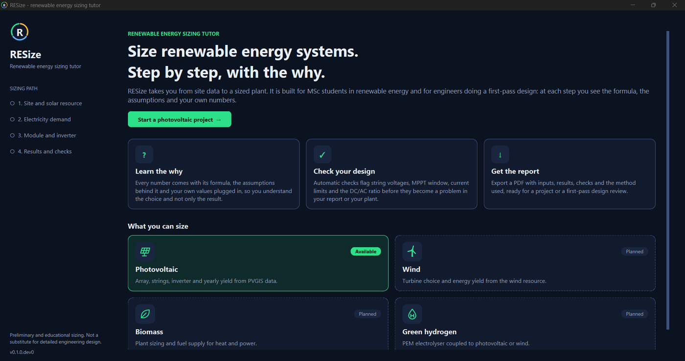
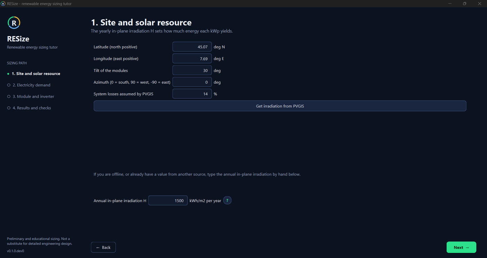
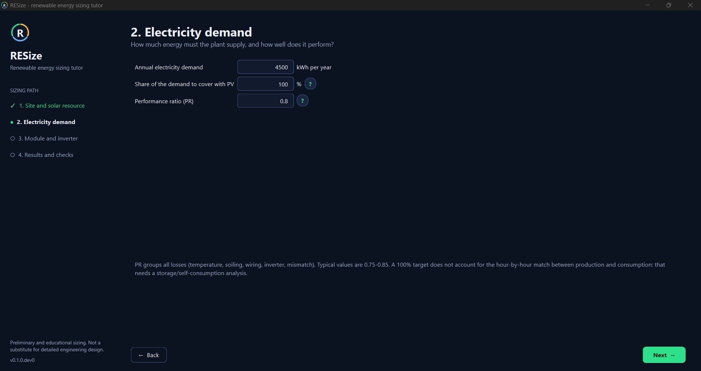
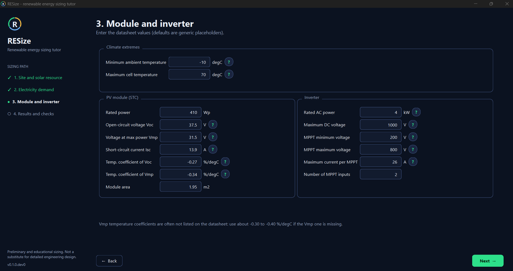
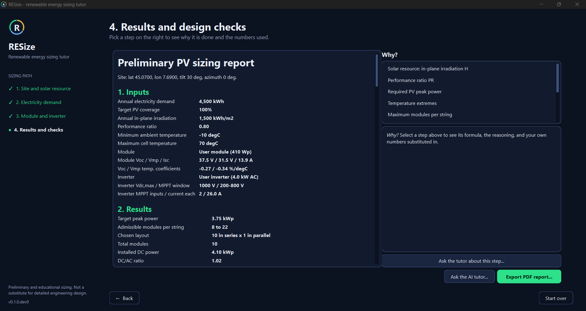

# RESize

**A step-by-step tutor for sizing renewable energy systems.**

RESize guides MSc students (and engineers doing a first-pass design) through the sizing of
renewable energy plants. At every step it shows the formula, the assumptions and the
reasoning, so you learn *why* a choice is made, not just the number that comes out.

> **Status:** early release (v0.1). Photovoltaic is available; wind, biomass and green hydrogen
> are planned. Interfaces and results may change.



## Download

Get the installer for your system from the
[Releases page](https://github.com/MatteoMazzanti99/RESize/releases):

| System | File | Notes |
|---|---|---|
| Windows | `RESize-windows.zip` | Unzip, run `RESize.exe`. Windows may warn about an unknown publisher (the app is not code-signed): *More info > Run anyway*. |
| macOS | `RESize-macos.zip` | Unzip, right-click `RESize.app` > *Open* the first time (not notarized). |
| Linux | `RESize-linux.tar.gz` | Extract, run `RESize/RESize`. Needs the usual Qt libraries (e.g. `libxkbcommon-x11-0`, `libxcb-cursor0`). |

Prefer Python? See *Quick start* below.

## How it looks

| 1. Site and solar resource | 2. Electricity demand |
|---|---|
|  |  |
| **3. Module and inverter** | **4. Results, checks and Why?** |
|  |  |

Validation against PVGIS and hand calculations: [docs/validation](docs/validation/README.md).

## Quick start

```bash
pip install -e ".[gui]"
resize            # opens the PV sizing wizard
resize-cli pv-power --demand-kwh 4800 --irradiation 1600 --pr 0.75
```

The wizard guides you through site and solar resource (PVGIS or manual input), demand,
module/inverter datasheet values, then shows the design, automatic checks and a PDF report.
Next to the main values a round **?** button explains the step, and on the results page a
**Why?** panel shows each formula with *your own numbers* substituted in. The same worked
examples are included in the PDF report.

## AI tutor (optional)

On the results page, **Ask the AI tutor...** opens a chat that knows your inputs, results and
design checks. It teaches rather than just answering: it explains the reasoning and may ask a
question to check your understanding. Three ways to use it, none required:

| Option | What you need |
|---|---|
| Anthropic (Claude) | your own API key from console.anthropic.com |
| OpenAI-compatible service | your own key, the service address and a model name |
| Ollama (local model) | [Ollama](https://ollama.com) running on your computer; no key, nothing leaves your PC |
| Any chatbot | the **Copy project for any chatbot** button, then paste the summary where you like |

Open **Settings...** in the tutor window to choose. The key is never written to a file: it can
be remembered in your system keyring (`pip install "resize-energy[ai]"`), read from the
`ANTHROPIC_API_KEY` / `OPENAI_API_KEY` environment variable, or kept only for the session. Your
project values are sent to the provider you choose; each question typically costs a few cents
or less. AI answers can be wrong: the formulas in the **Why?** panel are the reference.

## Roadmap

| Version | Content |
|---|---|
| v0.1 | Guided photovoltaic wizard (resource data, strings, inverter, losses, yield) + PDF report |
| v0.2 | "Why?" panels (done), rule-based design checker (done), optional AI tutor (done), Italian interface |
| v0.3 | Wind module + technology comparison (LCOE, payback, avoided CO2) |
| v0.4 | Green hydrogen: PEM electrolyser coupled to PV/wind |

## Design principles

- **Works without AI.** Explanations and the design checker are deterministic and offline.
- **AI is optional.** Bring your own API key (stored in the OS keyring) or a local model; or
  copy the project summary into any chatbot.
- **Core is a library.** `resize_energy.core` has no GUI dependency: use it from scripts and notebooks.
- **Validated.** Results are benchmarked against PVGIS / SAM; benchmarks live in `docs/validation/`.

## Repository layout

```
src/resize_energy/
  core/     calculation library (no GUI)
  gui/      desktop interface (PySide6)
  tutor/    explanations, design checker, optional AI backends
  report/   PDF/DOCX export
tests/
docs/
.github/workflows/   CI and release builds (installers for Windows, macOS, Linux)
```

## Development

```bash
python -m venv .venv && source .venv/bin/activate
pip install -e ".[dev,gui,pv]"
pytest
```

## Disclaimer

RESize is a tool for **preliminary and educational sizing**. It is not a substitute for
detailed engineering design, and results must not be used for executive projects without
independent verification. See [DISCLAIMER.md](DISCLAIMER.md).

## License

MIT, see [LICENSE](LICENSE).
